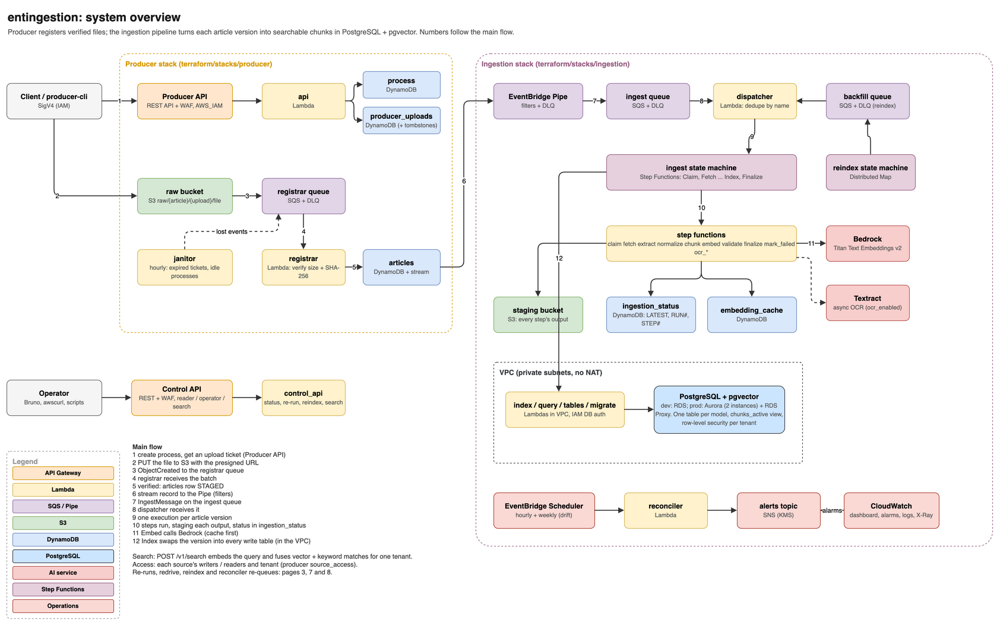
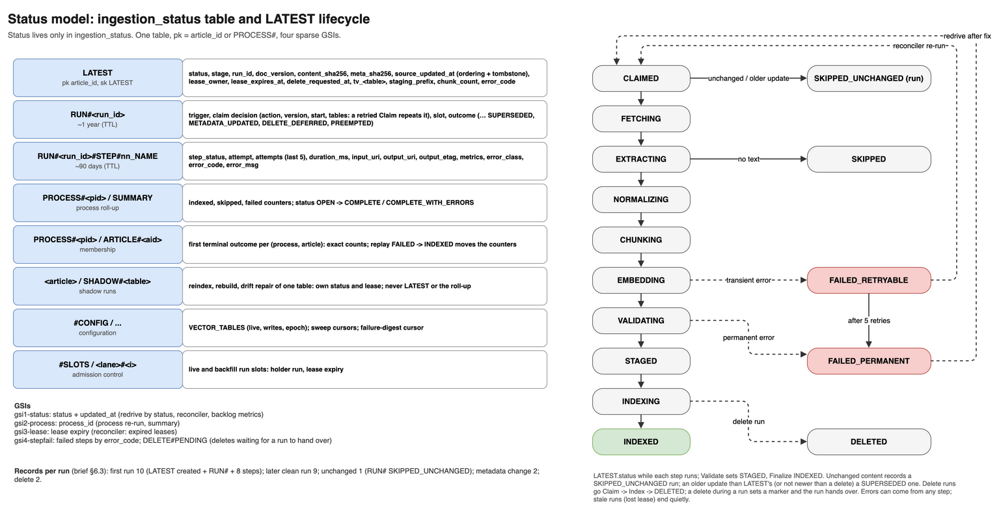
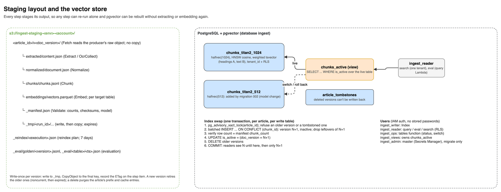
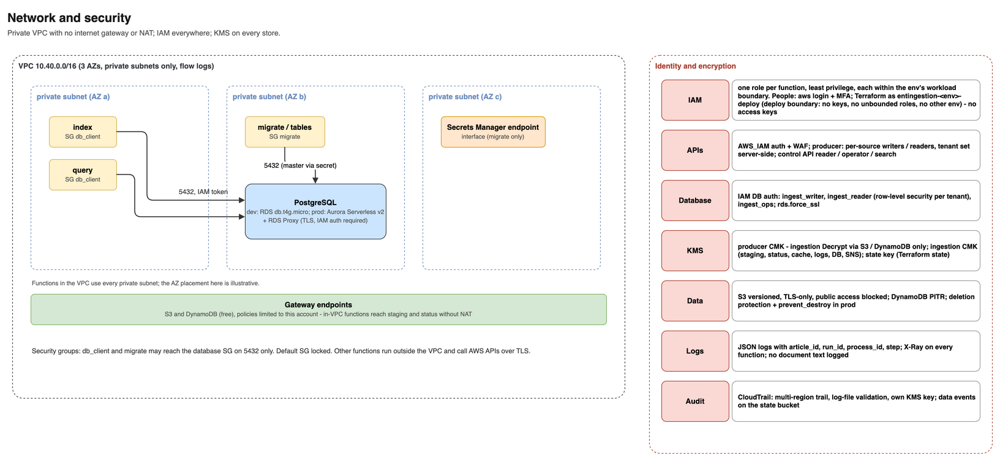

# Architecture

This document describes what the system is made of, the data it keeps, the guarantees it gives, and why it is built this way. For the step-by-step behaviour see [WORKFLOWS.md](WORKFLOWS.md). The design briefs are [`claude.md`](../claude.md) (producer) and [`INGESTION_HANDOFF_PROMPT.md`](../INGESTION_HANDOFF_PROMPT.md) (ingestion).

## 1. Requirements the design serves

1. **A row never points at a missing or corrupt file.** The producer writes an `articles` row only after S3 holds the object, and only if its size and SHA-256 match what the client declared.
2. **Every article version becomes validated, searchable chunks.** Readers see the old version until the new one commits, and then only the new one.
3. **Every step stages its output in S3.** Any step can re-run alone, and the vector store can be rebuilt without extracting or embedding again.
4. **Idempotent everywhere.** Duplicate events, retries and replays can't create duplicates, double-count, or roll back to older content.
5. **Status per article, run and step**, plus exact per-process counts that match the producer's.
6. **Operable:** a control API, an hourly reconciler, alarms, a dashboard and a runbook.
7. **All infrastructure in Terraform**, with IAM authentication, KMS encryption and least privilege throughout. Only open-source dependencies (no GPL, AGPL or commercial licenses).

## 2. Components

### Producer (`services/producer`, `terraform/stacks/producer`)

| Component | AWS service | Role |
|---|---|---|
| Producer API | API Gateway REST (`AWS_IAM`) + WAF → `api` Lambda | Processes, upload tickets, article reads, PATCH and DELETE |
| `process` table | DynamoDB | Process status (OPEN/CLOSED) and its counts |
| `producer_uploads` table | DynamoDB | Upload tickets and their states; membership markers that make counting exact |
| `articles` table | DynamoDB + stream (NEW_AND_OLD_IMAGES) | One row per article: **the contract with ingestion** |
| raw bucket | S3 (versioned, KMS) | `raw/{article_id}/{upload_id}/{filename}`, never overwritten |
| registrar | SQS (+DLQ) → Lambda | Verifies each uploaded object and upserts the `articles` row |

### Upload UI (`services/ui`, `terraform/stacks/ui`)

A hosted page for uploading a batch of files and following them to `INDEXED`. Details are in [UI.md](UI.md).

| Component | AWS service | Role |
|---|---|---|
| Distribution | CloudFront (PriceClass_100, default certificate) | Serves the SPA from the site bucket and `/api/*` from the BFF. Both origins sit behind OAC |
| Basic auth | CloudFront Function + KeyValueStore | Checks every request's `Authorization` header against a stored SHA-256. One shared login |
| Site bucket | S3 (SSE-S3) | The built React app; only this distribution may read it |
| BFF `ui-<env>-bff` | Lambda function URL (`AWS_IAM`) | The "static user": an allow-list of ten routes, SigV4-signed to the producer and control APIs, with a CSRF guard on POSTs |

The browser PUTs files straight to the raw bucket with each upload ticket's presigned URL. The raw bucket's CORS allows the UI's origin, which the producer stack reads from SSM.

### Ingestion (`services/ingestion`, `terraform/stacks/ingestion`)

| Function | Package | Memory / timeout | VPC | Role |
|---|---|---|---|---|
| dispatcher | core | 256 MB / 60 s | – | SQS → one Step Functions execution per article version |
| claim | core | 256 MB / 30 s | – | Takes the lease; decides NEW/CHANGED/UNCHANGED/DELETE; writes RUN# |
| fetch | core | 1 GB / 300 s | – | Reads the raw object, verifies its SHA-256, routes big PDFs to OCR |
| extract | docs | 2 GB / 900 s | – | HTML (trafilatura), PDF (pdfplumber), DOCX (mammoth), TXT/MD |
| normalize | docs | 1 GB / 300 s | – | Cleans text into ordered blocks with headings and pages |
| chunk | docs | 1 GB / 300 s | – | ~512-token chunks with 64-token overlap (tiktoken cl100k_base) |
| embed | core | 1 GB / 900 s | – | Embedding cache, then Bedrock Titan v2 for misses |
| validate | core | 1 GB / 300 s | – | The gate: counts, unique ids, dimensions, finite unit vectors, sizes → `_manifest.json` |
| index | core | 1 GB / 300 s | ✓ | Transactional version swap in pgvector; delete path |
| finalize | core | 256 MB / 60 s | – | INDEXED, lease release, process roll-up, `article.indexed` event |
| mark_failed | core | 256 MB / 60 s | – | Classifies the error, records it, alerts on permanent failures |
| ocr_start / ocr_poll / ocr_collect | core | 256 MB / 2 GB | – | Textract async text detection, driven by the state machine |
| migrate | core | 512 MB / 300 s | ✓ | Schema migrations, DB users, truncate (off in prod) |
| tables | core | 256 MB / 60 s | ✓ | Vector-table status and switch as `ingest_ops` (control API) |
| control_api | core | 512 MB / 29 s | – | Control API handler |
| reindex_plan / reindex_enqueue | core | 512 MB / 300 s | – | Reindex state machine tasks |
| query | core | 512 MB / 60 s | ✓ | Read-only vector queries as `ingest_reader` (search, eval, drift) |
| eval | core | 1 GB / 300 s | – | Retrieval evaluation (recall@5/@10, MRR) |
| reconciler | core | 512 MB / 300 s | – | Hourly repair; weekly drift check |

The functions ship as two zips:
- **`core`:** boto3, Powertools, psycopg and pyarrow.
- **`docs`:** the document libraries and the tokenizer.

`test_packages.py` imports every handler with the other package's modules blocked, which keeps the split honest.

Other ingestion resources:
- **Queues and routing:** an EventBridge Pipe (stream → ingest queue), and the ingest and backfill queues, each with a DLQ.
- **State machines:** ingest (Standard) and reindex (Standard with a Distributed Map).
- **Data:** the staging bucket, the `ingestion_status` and `embedding_cache` tables, and PostgreSQL with pgvector (an RDS instance in dev, Aurora Serverless v2 with RDS Proxy in prod).
- **Network:** a private VPC with endpoints.
- **Operations:** EventBridge Scheduler, an SNS alerts topic, and a CloudWatch dashboard and alarms.
- **Edge:** the control API (REST + WAF).

## 3. Contracts

### The `articles` row (producer → ingestion)

`process_id, first_process_id, source, external_id?, title?, filename, content_type, s3_uri, s3_key, s3_version_id, content_sha256, size_bytes, upload_id, status ("STAGED"), metadata, created_at, updated_at, updated_date`

- **`article_id`** is `art_` + uuid5(`source` + `external_id`) when `external_id` is given, so re-sending a document updates the same article. Without one, every upload gets a new `art_<ULID>`.
- **The Pipe** forwards only `INSERT`/`MODIFY` events with `status = STAGED`, plus `REMOVE` events.
- **Process totals:** once the producer's process is settled, its total is `registered_count`.

### The `IngestMessage` (queues → dispatcher → state machine)

| Field | Meaning |
|---|---|
| `article_id`, `process_id` | Which article; which process the event belongs to |
| `event` | `UPSERT` or `REMOVE` |
| `s3_uri`, `s3_version_id`, `content_sha256` | The exact object version and its checksum (no S3 HEAD needed) |
| `source_updated_at` | The producer's `updated_at`: part of the execution name, and the start of freshness lag |
| `trigger` | `STREAM`, `MANUAL`, `RECONCILER` or `BACKFILL` |
| `force`, `from_stage` | Re-run regardless of the unchanged check; start at a given step |
| `tenant_id` | The producer row's tenant: picks the tenant's vector-table registry (default registry when empty) |
| `target_table` | Vector table for reindex runs (default: the configured live table) |
| `requested_by`, `priority` | Audit; backfill runs at lower priority |

## 4. The ingest run

| # | Step | Reads | Writes to staging | LATEST.status while / after |
|---|---|---|---|---|
| 0 | Claim | LATEST, message | – | CLAIMED |
| 1 | Fetch | raw object (producer bucket) | – (routes to OCR if a PDF is over 50 MB) | FETCHING |
| 2 | Extract | raw object | `extracted/content.json` | EXTRACTING |
| 2a | OCR (Start → Wait/Poll → Collect) | raw object via Textract | `extracted/content.json` | EXTRACTING |
| 3 | Normalize | `extracted/` | `normalized/document.json` | NORMALIZING |
| 4 | Chunk | `normalized/` | `chunks/chunks.jsonl` | CHUNKING |
| 5 | Embed | `chunks/`, cache | `embeddings/vectors.parquet` | EMBEDDING |
| 6 | Validate | `chunks/`, `embeddings/` | `_manifest.json` | VALIDATING → STAGED |
| 7 | Index | manifest, vectors | – (pgvector) | INDEXING |
| 8 | Finalize | manifest | – | INDEXED |

**Step protocol.** Every step follows the same pattern (`steps/protocol.py`):

1. **Start.** A DynamoDB transaction moves LATEST to the step and puts the step item STARTED. It requires that the run still holds the lease, that the lease hasn't expired, and that LATEST is at the previous stage. If any condition fails, the run is stale and ends quietly.
2. **Work.** The step writes its output to `_tmp/<run_id>/…`, copies it to the final key, and records the ETag on the step item.
3. **Success.** The step item becomes SUCCEEDED, with timings, URIs and metrics, and the lease is extended.
4. **Failure.** The error is classified (see section 7). Transient errors are retried by the state machine on the same step item, with `attempt` incremented.

**Records per run** (brief §6.3):

| Run | Records |
|---|---|
| First run | 10: LATEST created, RUN#, 8 step items |
| Later clean run | 9 |
| Unchanged content | 1: RUN# SKIPPED_UNCHANGED |
| Metadata-only change (PATCH) | 2: RUN# METADATA_UPDATED + the Index step |
| Delete | 2 |

## 5. Data model

### `ingestion_status` (DynamoDB)

| Item | Key | Contents | Retention |
|---|---|---|---|
| LATEST | `article_id` / `LATEST` | status, stage, run_id, doc_version, content_sha256, pipeline_version, process_id, tenant_id, lease, staging_prefix, chunk_count, error_code, indexed_at, `tv_<table>` (version last written to each table) | while the article exists |
| Run | `article_id` / `RUN#<run_id>` | trigger, claim, outcome, execution_arn, timings | 1 year (TTL) |
| Step | `article_id` / `RUN#<run_id>#STEP#nn_NAME` | step_status, attempt, last 5 attempts, duration, URIs, ETag, metrics, error | 90 days (TTL) |
| Process summary | `PROCESS#<pid>` / `SUMMARY` | indexed / skipped / failed counters; OPEN → COMPLETE or COMPLETE_WITH_ERRORS | – |
| Membership | `PROCESS#<pid>` / `ARTICLE#<aid>` | first terminal outcome per (process, article) | – |
| Admission slot | `#SLOTS` / `<lane>#<i>` (lanes `live`, `backfill`) | run_id holding it, expires_at (a lease, extended at every step) | reused; a missing item is a free slot |
| Config and cursors | `#CONFIG` / `VECTOR_TABLES`, `VECTOR_TABLES#<tenant>`, `SWEEP#...`, `ALERT#FAILED_DIGEST` | the default and per-tenant vector-table registries, sweep cursors, the failure digest's cursor | – |

GSIs (sparse):

| GSI | Key | Used by |
|---|---|---|
| `gsi1-status` | status / updated_at | Redrive by status; reconciler; reindex planning |
| `gsi2-process` | process_id | Process re-run and summary |
| `gsi3-lease` | lease expiry | Reconciler: expired leases |
| `gsi4-stepfail` | failed steps | Failures by error code |

### Staging (S3) and the vector store (PostgreSQL + pgvector)

**Staging** keeps one prefix per article version: `<article_id>/v<doc_version>/`.
- A non-default target table gets its own `embeddings/<table>.parquet` and `_manifest.<table>.json`, so a reindex never overwrites what the live table is rebuilt from.
- Lifecycle: Finalize of a new version deletes the older versions' files, so they turn noncurrent; noncurrent versions move to Glacier IR after 30 days and expire after `staging_noncurrent_expiration_days` (90). The current version stays: it is the rebuild source. `_tmp/` and `_reindex/` expire. A delete removes every version of the article's files (and its embedding-cache entries) at once.

**Vector tables:**
- **One table per embedding profile** (model and dimension, [§8](#embedding-models)): `chunks_titan2_1024` (live) and `chunks_titan2_512` (migration 002); `migrate` creates the table of any other profile with the same structure.
- **Columns:** `chunk_id` (sha256 of article, version and ordinal), `article_id`, `doc_version`, `ordinal`, `parent_id`, `parent_text`, `process_id`, `tenant_id` (NOT NULL, `default` when the producer row has none), `source`, `published_at` (date), `is_active`, `text`, `embed_text`, `heading_path`, `page_start`, `page_end`, `char_start`, `char_end`, `token_count`, `metadata`, `content_tsv` (generated: heading path weight A, text weight B), `embedding halfvec(N)`, `embedding_model`, `pipeline_version`, `created_at`.
- **Indexes:**
  - HNSW (cosine) on the embedding;
  - `(article_id, doc_version)`;
  - GIN on `content_tsv`, active rows only;
  - `tenant_id`, `source`, `published_at`, active rows only.
- **Row-level security** (migration 005): `ingest_reader` sees the rows of `app.tenant_id` (set per transaction by search), or every row when the query function's internal actions (evaluation, drift check) set `app.all_tenants`; neither set, nothing. `ingest_writer` and `ingest_views` see every row; the tables' owner bypasses RLS.

**`chunks_active`** is a view over the live table's active rows, and readers use only this view. It is created `WITH (security_invoker = true)`, so row-level security applies as the caller, not as the view's owner. Switching models replaces the view in one transaction (DROP and CREATE), and so does rolling back.

**The Index swap** happens in one transaction per article:
1. Take an advisory lock on the article.
2. COPY the new version in, inactive.
3. Verify the row count against the manifest.
4. Flip `is_active` to the new version.
5. Delete the older versions.

Readers see version N until the commit, and only N+1 after it.

**Database users** authenticate with IAM tokens; the app users have no stored passwords:
- `ingest_writer`: Index and migrate.
- `ingest_reader`: query and eval.
- `ingest_ops`: tables (status, switch `chunks_active`). Reads the vector tables; acts as `ingest_views`, the view's owner.
- `ingest_admin`: the master user, whose secret only migrate reads.

## 6. Entry points and dispatch

- **Stream:** producer change → Pipe (filtered) → ingest queue.
- **Manual:** control API `/v1/ingest`, `/v1/processes/{id}/ingest`, `/v1/dlq/redrive` → ingest queue.
- **Reconciler:** hourly re-queues → ingest queue.
- **Backfill:** reindex state machine → backfill queue.

The dispatcher turns each message into one execution named `{article_id}-{sha256(content_sha256|process_id|source_updated_at|pipeline_version)[:32]}`:
- The same stream record delivered three times starts one execution (DUP).
- A PATCH or an unchanged article joining a new process still gets its own run, so it can be counted.
- MANUAL, RECONCILER and BACKFILL runs append `-r<run id>`, so a replay always starts.

**Admission control (backpressure).** Before StartExecution the dispatcher takes a slot of the message's lane: `live` for the ingest queue (`live_slots`, default 2 x Embed's reserved concurrency, else 8) and `backfill` for the backfill queue (`backfill_slots`, 2). A slot is a conditional write on `#SLOTS/<lane>#<i>` (free, or its lease expired), holds the run id, rides in the execution input and on RUN#, is extended at every step, and is released however the run ends (finish, retryable, handover to a delete, Claim SKIP/STALE/DONE, MarkFailed, a stale exit); a run that dies frees it when the lease runs out. With every slot busy the dispatcher waits up to 40 s, then returns the rest of its batch as item failures (visible again in 30 s): work waits on the queue, where its age is the real backlog, instead of piling up as executions that all hit Bedrock and the database at once. `dispatcher_max_concurrency` only bounds how fast runs start. Unparseable bodies go straight to the DLQ, so the queues' high `maxReceiveCount` (50) only covers waiting.

## 7. Reliability

### Errors

Every error is classified (`errors.py`):

| Class | Codes | Handling |
|---|---|---|
| transient | `E_THROTTLED`, `E_UPSTREAM_5XX`, `E_TIMEOUT`, `E_DB_CONN`, `E_DB_CONFLICT`, `E_DB_SCHEMA` | The state machine retries with backoff and jitter (throttling: 12 attempts up to 120 s apart). If retries run out, the article is FAILED_RETRYABLE and the reconciler retries it up to 5 times, then marks it FAILED_PERMANENT. Throttling has its own budget (20) |
| permanent | `E_SOURCE_MISSING`, `E_SOURCE_CHANGED`, `E_UNREADABLE`, `E_TOO_LARGE`, `E_UPSTREAM_4XX`, `E_VALIDATION_<CHECK>`, `E_BUG` | FAILED_PERMANENT, counted (`ArticlesFailedPermanent` by code) and in the reconciler's hourly digest. Replay after the fix (redrive by error code) |
| skip | `E_EMPTY_TEXT` | SKIPPED, counted as skipped |

Unknown exceptions are permanent, so there are no unbounded retries. psycopg errors are classified by SQLSTATE and class hierarchy: connection failures are transient, and so is a missing table or column (42P01/42703, `E_DB_SCHEMA`), so runs survive code that's deployed before its migration. A run has a 3-hour execution timeout, and the OCR poll loop gives up after `ocr_max_wait_seconds` (E_TIMEOUT, retryable).

### Other guarantees

- **Leases.** Claim takes a lease (`LEASE_SECONDS`, 35 minutes: longer than any step plus its retries), long steps extend it, and every step re-checks that the run still owns it. When two runs race for one article (CONC), one wins and the other exits quietly as Stale.
- **Resume.** A replay starts after the last SUCCEEDED step whose staged output still has the recorded ETag. If Fetch succeeded, it starts at Extract.
- **Exact process counts.**
  - Each (process, article) pair's first terminal outcome writes a membership item and increments a counter, in one transaction.
  - A replay that turns FAILED into INDEXED moves both counters (`failed −1, indexed +1`).
  - The summary becomes COMPLETE when the counts reach the producer's `registered_count`, and emits `process.ingested`.
- **Reconciler** (hourly; see [WORKFLOWS.md](WORKFLOWS.md#w9-reconciler-hourly-and-drift-check-weekly)). It only enqueues work, or moves items after re-checking them in a conditional write, so every step is idempotent.
- **DynamoDB transaction conflicts** are retried with jittered backoff, in both services.

## 8. Retrieval, embedding models, reindex and evaluation

### Embedding models

Every vector table is an **embedding profile**: a model and how to call it, in the table
`chunks_<profile>`. Terraform's `embedding_profiles` reaches every function as JSON
(`EMBEDDING_PROFILES`, parsed by `embedding/profiles.py`). The defaults are the two tables from
before profiles, so names, staged files and cache keys stay as they were:

| Profile | Provider | Model | Dimension | Table |
|---|---|---|---|---|
| `titan2_1024` (default) | `bedrock` | `amazon.titan-embed-text-v2:0` | 1024 | `chunks_titan2_1024` |
| `titan2_512` | `bedrock` | `amazon.titan-embed-text-v2:0` | 512 | `chunks_titan2_512` |

A profile has `provider`, `model`, `dimension` (1–4000, pgvector's HNSW limit for `halfvec`),
`normalize` (default true), `batch_size` (16), `max_input_tokens` (8192) and, as needed,
`base_url`, `api_key_secret`, `document_input_type`, `query_input_type`, `send_dimensions`.
A profile's model and dimension never change once its table has data: add a new profile.

**Providers** (`embedding/`), behind one interface (`embed_documents`, `embed_query`):

| Provider | Models | Calls |
|---|---|---|
| `bedrock` | `amazon.titan-embed-text-v2*` | InvokeModel `{inputText, dimensions, normalize}`, one text per call (the Embed step runs `embed_threads` at once). The model normalizes; it reports each text's tokens |
| `bedrock` | `cohere.embed-*` (english/multilingual v3, v4) | InvokeModel `{texts: [≤ 96], input_type, truncate: END, embedding_types: [float]}` (+ `output_dimension` on v4). `search_document` for chunks, `search_query` for queries unless the profile says otherwise. Vectors are L2-normalized by the pipeline; the token total (response header) is spread over the batch |
| `openai_compatible` | anything behind the OpenAI embeddings API: a LiteLLM proxy, vLLM, TEI, Ollama | `POST {base_url}/embeddings {model, input: [batch], dimensions?, input_type?}` with `urllib` (no SDK, and not the `litellm` package: its size and its non-MIT enterprise code). `Authorization: Bearer` from the Secrets Manager secret `api_key_secret` (read once per container). 429 → `E_THROTTLED`, 5xx/connection → `E_UPSTREAM_5XX`, timeout → `E_TIMEOUT` (each retried 3 times in the call, then by the state machine), other 4xx → `E_UPSTREAM_4XX` (permanent). Normalized by the pipeline |

An unknown Bedrock family is refused (Terraform validation, and at start-up). The dev and prod
tfvars configure only Bedrock profiles; `openai_compatible` is there for later.

**Tables from profiles.** After the numbered migrations, `migrate` creates the table of every
profile that has none (`vectorstore/profile_tables.py`): `LIKE chunks_titan2_1024` (columns,
defaults, NOT NULLs, the weighted `content_tsv`), `embedding halfvec(<dimension>)`, the primary
key and `tenant_id <> ''` check, the same partial HNSW / GIN / article-version / tenant / source /
published_at indexes, row-level security with the same three policies, and the same grants
(including `ingest_views`, so `chunks_active` can serve it). It is idempotent, refuses a table
whose dimension differs from its profile's, and records every table in `profile_tables`
(migration 007).

**Per-tenant registries.** Which tables runs write and which one search reads is kept per tenant
(`vectorstore/registry.py`, items in `ingestion_status`):
- `#CONFIG/VECTOR_TABLES`, the **default registry**: every tenant without its own, and articles
  without a tenant. Before it has an item: the `default_profile` table alone. `chunks_active`
  serves its live table.
- `#CONFIG/VECTOR_TABLES#<tenant>`, a **tenant's own registry**: stored on its first change
  (a reindex, switch or retire with that `tenant_id`, copied from the default registry), or implied
  by `tenant_profiles` (Terraform; `TENANT_PROFILES`) as `{live: chunks_<profile>, writes: [it]}`
  until then. `tenant_profiles` is for new tenants: mapping a tenant that already has articles
  switches its searches to a table that doesn't have them yet.

The dispatcher and requeue put the producer row's `tenant_id` on the `IngestMessage`; Claim
writes the tenant's registry's tables and records `tenant_id` on LATEST. Search embeds the query
with the tenant's live profile (as a query) and reads that table directly (`is_active` rows,
row-level security as before), not `chunks_active`. With no tenant registries, everything behaves
as before.

An article whose tenant changes to one whose registry writes **other tables** is re-run (new
version) rather than metadata-updated; after any live run, Index re-tags the article's rows in
tables its tenant doesn't write with the new tenant (rows are kept, for rollbacks), so the old
tenant's searches can't see them. Within one registry, a tenant change stays a metadata update.

**Cache keys.** `sha256(embed_text)#model@dim@norm` for Bedrock Titan (unchanged, so existing
entries stay valid); every other profile adds `#<fingerprint>` of provider, model, dimension,
normalization, endpoint host, document input type and `send_dimensions`, so two endpoints or
settings never share entries.

**Validate** checks chunks against the profile's input limit (`max_input_tokens`, capped by the
family: Titan 8,192, Cohere v3 512, v4 128k). The counts are the chunker's (cl100k), an
approximation of the model's tokenizer; a chunk above the limit fails `oversized` instead of being
truncated silently (Cohere truncates at the end). Model-reported token counts are checked only
where they are per text (Titan). The unit-length check applies only to profiles that normalize.

### Reindex, search and evaluation

- **Targets.** `vectorstore/targets.py` maps each profile's table to its profile. A run's `target_table` selects the embedding profile, the staged vector file and the table.
- **Reindex.** `POST /v1/reindex` starts the reindex state machine:
  1. It plans the matching articles into an S3 JSON file.
  2. A Distributed Map reads that file in batches. Each batch is an EXPRESS child execution, which enqueues messages to the backfill queue.
  3. Each article then runs from Embed (model change) or from Index (rebuild, with no Bedrock calls).
- **Search.** `POST /v1/search` on the control API (outside the VPC, so it reaches Bedrock):
  1. Authorization: the caller must read or write a source of the requested tenant, per the producer's `source_access` SSM parameter (cached 5 minutes; no parameter allows nothing).
  2. The query is embedded with the tenant's live table's profile ([registries](#embedding-models)); the `query` function (`search_hybrid`, as `ingest_reader`, `app.tenant_id` set) takes the nearest vectors and the best `websearch_to_tsquery` matches (50+ each) and fuses them by reciprocal rank (k = 60), with optional filters on source, published date and process.
  3. Optional Bedrock rerank (`rerank_enabled`, off by default); on any error the fused order stands.
  Every search sets `hnsw.ef_search = max(100, 2 x candidates)` and `hnsw.iterative_scan = relaxed_order` (the default 40 couldn't return k = 50).
- **Chunks.** Structure-aware (sections, sentences; tables and code atomic, a split table repeats its header row); small sibling sections merge under their parent heading; a heading with nothing under it is kept. Each chunk cites `char_start`/`char_end` in the normalized text (blocks joined by blank lines) and its pages. **Parent-child** (`parent_child_enabled`, off): children of ~256 tokens are embedded and matched; their section-level parent (up to ~1,024 tokens) is stored on each child (`parent_text`) and returned as `context`. Parents get no rows or vectors of their own, so nothing else (Index, deletes, drift check, RLS) changes.
- **Embedding cache key:** see [Embedding models](#embedding-models).
- **Metadata-only changes.** The dispatcher fingerprints each row's title + metadata + tenant (`meta_sha256`) and its title (`title_sha256`); LATEST keeps both. Same content and title with other metadata is Claim's `METADATA` action: Index rewrites tenant, source, published date and metadata on the active rows of every write table and ends the run (counted as skipped). A new title is a content change (it's in every `embed_text`): a new version. Index always takes these fields from the producer's current row, so replays and rebuilds write current values.
- **Evaluation.**
  - **Golden set:** `_eval/golden/<YYYYMMDD-HHMM>.jsonl`, never overwritten, and `_eval/golden/LATEST` naming the current one. `make_golden_set.py` samples chunks across each document and has Nova Lite write a question per chunk, labelled with its `chunk_id` and the article version, plus no-answer questions.
  - **Scoring:** the eval Lambda embeds each question, has `query` fetch the nearest 50 chunks, and scores chunk-level recall@5, recall@10, nDCG@10 and MRR (plus article recall@10), each with a bootstrap 95% CI. Questions whose article was deleted or changed version are dropped and counted.
  - **Outputs:** `_eval/<table>/<time>.json` (naming the golden set) and CloudWatch metrics. `{"baseline": true}` also scores the live table.
- **Switch and roll back.** `POST /v1/tables/active` makes the chosen table live for the default registry (and points `chunks_active` at it) or, with `tenant_id`, for that tenant's registry only, after the coverage check (that tenant's indexed articles) and the **evaluation gate**: the table's newest report (< 7 days) must have recall@10 at least the live table's (same golden set) minus `eval_tolerance` (0.02). `force` skips both. Reports are per table, not per tenant: the golden set spans every tenant.
- **Drift check** (weekly): every table any registry writes, each article checked only against its own registry's tables (its tenant's, else the default one). Rows in a table the article's registry doesn't write are left alone (rollback); rows of deleted or unknown articles are removed.
- **PII** (`pii_screening`, off): Normalize screens the text with Comprehend and applies the source's `pii` policy from `source_access`: `block` (SKIPPED, `E_PII_BLOCKED`), `redact` (`[TYPE]`), or `allow` (default; recorded). The finding is on the normalized document and LATEST.

## 9. Security

- **Network:** a private VPC with 3 AZs, private subnets only, no IGW or NAT, and flow logs.
  - Gateway endpoints for S3 and DynamoDB are free.
  - One interface endpoint, Secrets Manager, serves migrate.
  - Only `index`, `query`, `tables` and `migrate` run in the VPC, and only their security groups can reach the database on 5432.
  - The gateway endpoint policies admit only this account's buckets and tables.
- **Identity:**
  - One IAM role per function, with no wildcard resources (a stack test checks this).
  - Every role carries the workload permissions boundary (no IAM, no state, no other environment); see [AWS_ACCESS.md](AWS_ACCESS.md).
  - Producer resources are read-only for ingestion.
  - Both APIs use `AWS_IAM` auth and WAF; the control API has separate reader and operator policies.
- **Encryption:**
  - The producer key covers the raw bucket, its tables and the stream; ingestion has decrypt-only access, and only through S3 or DynamoDB (`kms:ViaService`).
  - The ingestion key covers staging, the status and cache tables, logs, the database, SNS and the state machines.
  - TLS everywhere: `rds.force_ssl`, and the S3 bucket and SQS queue policies deny non-TLS requests.
- **Logs:** JSON, with no document text.

## 10. Observability

| Signal | Where |
|---|---|
| Logs | `/aws/lambda/ingestion-<env>-<fn>`, JSON with `article_id`, `run_id`, `process_id`, `step`, `attempt`; X-Ray traces |
| Custom metrics (namespace `Ingestion`, dimension `service=ingestion`) | `StepDuration_<STEP>`, `StepFailed_<STEP>`, `Dispatch_started` / `_duplicate` / `_waiting_<lane>` / `_error` / `_poison`, `Run_INDEXED`, `Run_SKIPPED`, `Run_FAILED_*`, `ArticlesFailedPermanent` (+ `error_code`), `FreshnessLagSeconds` (+ `Trigger`), `BacklogCount` / `BacklogOldestSeconds` (+ `status`, hourly), `Reconciler_*`, `Requeued_manual`, `Eval_recall_at_5` / `_at_10` / `_mrr` (per table) |
| SLOs | Freshness p95 < 15 min (stream runs), < 1% of runs failing permanently, no article in a running status over 30 min; each has an alarm ([RUNBOOK.md](RUNBOOK.md#slos)) |
| Alarms | DLQs (new messages, and undrained for a day), queue age, failed and timed-out runs, the three SLOs, step p95 per step, Bedrock throttles, reconciler, dispatcher, control API 5XX, database (per mode). On ALARM only; prod can't be planned without a subscriber. Permanent failures: one hourly digest. Actions for each are in [RUNBOOK.md](RUNBOOK.md#alarms) |
| Dashboard | `ingestion-<env>` |

## 11. Environments

| Setting | dev | prod |
|---|---|---|
| Table names | `dev-` prefix | none |
| Database | `database_mode = "rds"`: one `db.t4g.micro`, direct IAM auth | `aurora`: Serverless v2 0.5–8 ACU + RDS Proxy |
| Backups | 1 day | 7 days, final snapshot, deletion protection, `prevent_destroy`; AWS Backup daily for 35 days, copied to us-east-2 (`backup_enabled`) |
| OCR | off (free plan) | on (Textract) |
| Embed reserved concurrency | none (10-concurrency account) | 4 |
| Freshness alarm (p95, stream runs) | 15 min | 15 min |
| Alarm subscribers | optional | required (the plan fails without `alarm_emails`) |
| Reserved concurrency | none | dispatcher 5, control API 5, index 10, registrar 10, producer API 10 (shared account) |
| Logs | DEBUG, 30 days | INFO, 90 days |
| Buckets | force-destroyable | not |

Code is identical across environments. Only `terraform/envs/<env>/*.tfvars` and the backend files differ.

## 12. Infrastructure layout

- **Modules:** 19 generic modules in `terraform/modules/`, each with tests, a README and an example, tagged `modules/<name>/vX.Y.Z`. They hold nothing service-specific.
- **Stacks:** `stacks/producer`, `stacks/ingestion` and `stacks/ui` compose the modules. Ingestion reads producer values from SSM, never from the producer's state. The ui stack reads both APIs from SSM and publishes its origin there for the producer's CORS ([UI.md](UI.md#first-time-setup) has the first-time apply order).
- **Make targets:**
  - `make plan|apply ENV= STACK=` pairs the environment's backend with its tfvars; `make deploy` is plan + confirm + apply (+ `migrate` for ingestion).
  - Every function publishes a version per change behind a `live` alias that all callers use; `make rollback ENV= FN= VERSION=` moves it back.
  - `make check` runs the static checks.
  - `make destroy[-all]` tears down disposable environments.
  - `make ui-password|ui-deploy|ui-url|ui-dev ENV=` operate the upload UI.

## 13. Decisions that differ from the briefs

| Brief | Implemented | Why |
|---|---|---|
| Execution name `{article_id}#{sha16}#{pipeline_version}` | `{article_id}-{sha256(content, process, updated_at, version)[:32]}` | Step Functions rejects `#`. The brief's key would also drop events that UC3 and UC11 must count |
| Roll-up on LATEST transitions | Membership item per (process, article) | One article can belong to several processes |
| Dispatcher concurrency bounds Bedrock | Embed's reserved concurrency bounds Bedrock calls, admission slots bound runs in flight | The dispatcher's concurrency only limits how fast executions start |
| An SNS alert per permanently failed article | `ArticlesFailedPermanent` metric + one hourly digest | A bad batch would otherwise send thousands of emails |
| Titan tokenizer | tiktoken `cl100k_base`, bundled | Titan's tokenizer isn't published; Bedrock's token count is validated |
| PyMuPDF for PDF | pdfplumber (MIT) | PyMuPDF is AGPL or commercial |
| Aurora + RDS Proxy everywhere | `database_mode`: RDS in dev, Aurora + Proxy in prod | The free plan has neither Aurora (in Terraform) nor RDS Proxy |
| Fargate + Textract worker for large documents | Textract async driven by Step Functions (OcrStart → Wait/Poll → OcrCollect) | No container image to build or patch, and no ECR or interface endpoints (about $45/month less). Behind `ocr_enabled` |
| Validate sets STAGED on start | VALIDATING while running, STAGED on success | The reconciler re-indexes anything STAGED for 30 minutes |

## 14. Known limits and open items

- **OCR with real Textract is unverified,** because the dev account is on the free plan. UC12 runs in the first paid environment.
- **Not built yet:** HNSW drop-and-rebuild for bulk loads; the evaluation gate in CI, which needs AWS credentials in CI.
- **Unverified on AWS** (static work and local tests only): hybrid search and rerank against Bedrock, Textract LAYOUT/TABLES output on real scans, Comprehend PII screening, and migrations 005/006 on RDS/Aurora (tested on PostgreSQL 18 + pgvector 0.8.1 with non-superuser roles).
- **Embedding endpoints:** Embed, the control API and eval run outside the VPC (no NAT), so an `openai_compatible` endpoint must be reachable from the internet over HTTPS with an API key. An endpoint inside the VPC needs those functions in the VPC with a NAT gateway (or the endpoint behind a public load balancer); not built. Chunk size is global (one chunking per article), so a model with a small input limit (Cohere v3: 512 tokens) needs smaller chunks or parent-child chunking for every table. Evaluation reports are per table, not per tenant. Articles indexed before LATEST recorded `tenant_id` fall back to the producer row's tenant (a BatchGetItem) when some tenant has its own registry; tenant moves are only detected for articles whose LATEST has it. The `openai_compatible` path and Cohere on Bedrock are unit-tested against stubs, not yet against real endpoints.
- **Dev concurrency:** the dev account's 10-concurrency Lambda limit slows big reindexes and can throttle the control API.
- **Open decisions:** alarm email subscriptions are parked (prod plans fail until `alarm_emails` is set), and the choice between Terraform and OpenTofu (Terraform is BUSL-licensed) is still open.
- **DR follow-ups:** S3 cross-region replication of the raw and staging buckets; a rehearsed region failover (backups are copied, no standby stack). The DLQ new-message alarms (`DIFF` of the visible count) and the slot waiting behaviour are unverified on AWS.
- **Costs** per environment: [COSTS.md](COSTS.md).
