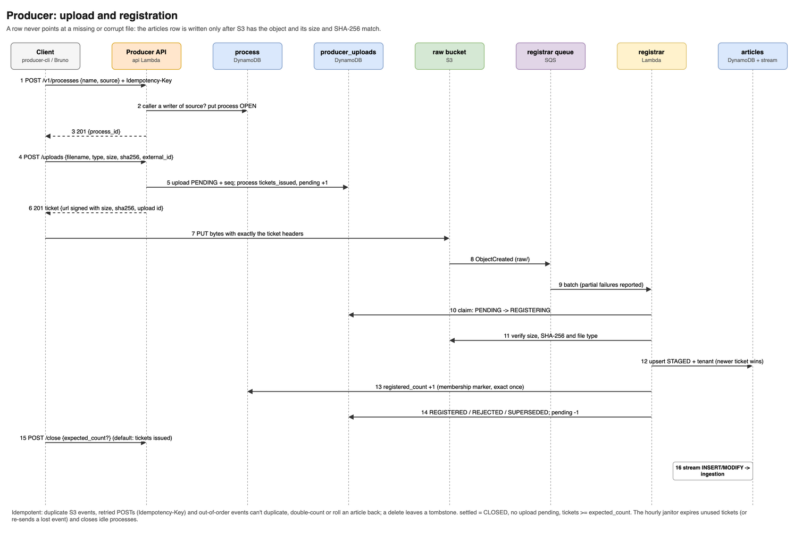
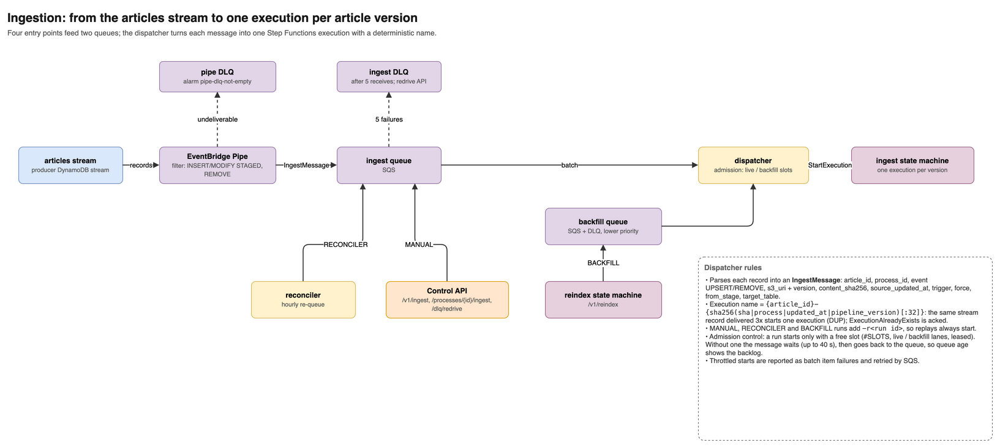
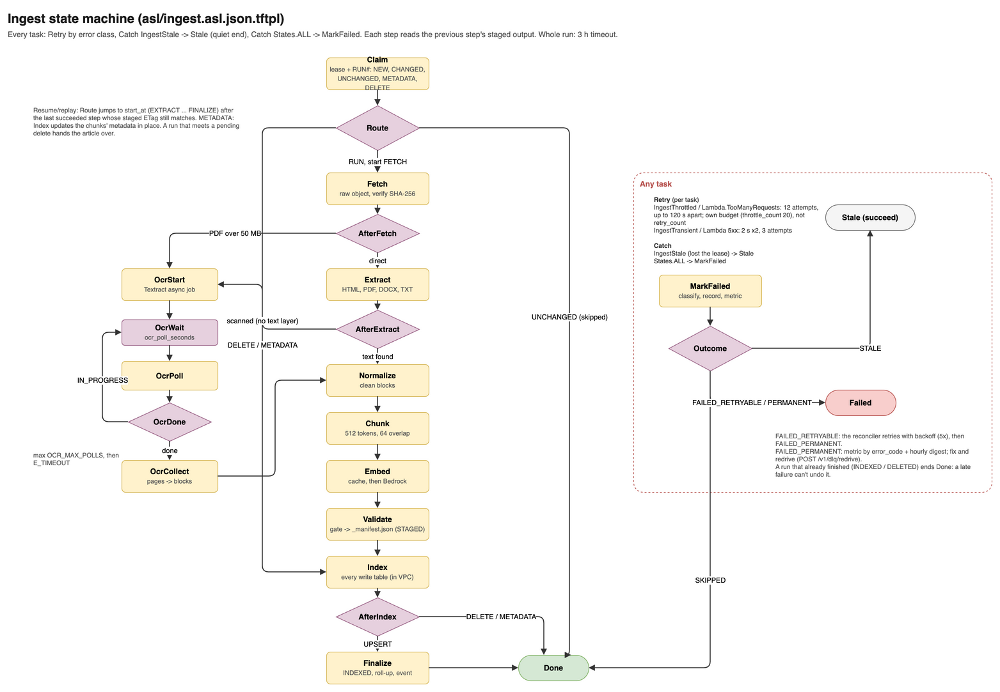
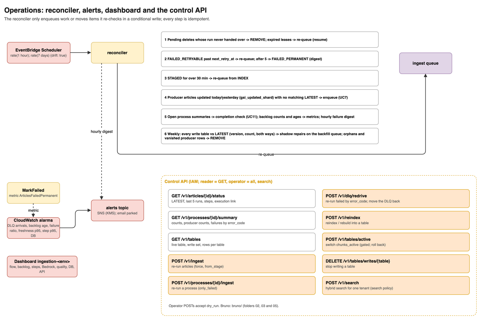
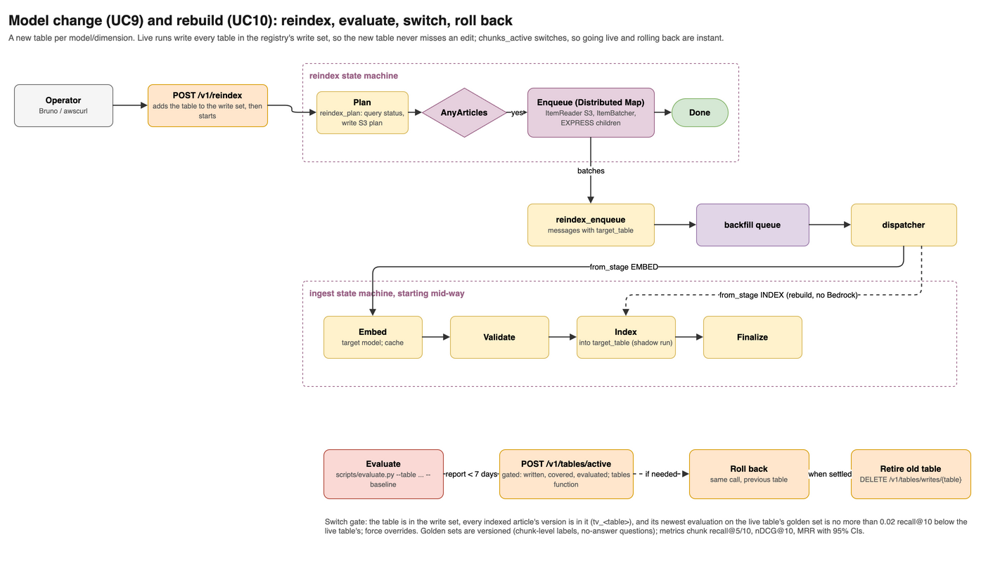
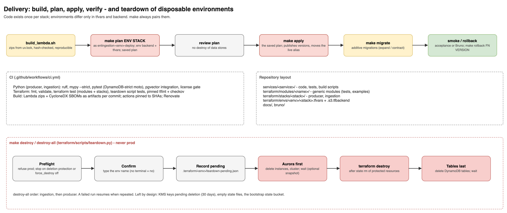

# Workflows

What happens, step by step, in each of the system's workflows: who starts it, what each component does, where the result is recorded, and how to watch it. The data model is explained in [ARCHITECTURE.md](ARCHITECTURE.md). Exact commands for incidents are in [RUNBOOK.md](RUNBOOK.md). Bruno requests are named as `folder / request`, from [bruno/](../bruno/README.md).

| # | Workflow | Started by |
|---|---|---|
| [W1](#w1-upload-and-register-a-document) | Upload and register a document | Client |
| [W2](#w2-ingest-a-new-article) | Ingest a new article | `articles` stream |
| [W3](#w3-ingest-changed-content-new-version) | Ingest changed content (new version) | Client re-sends a document |
| [W4](#w4-unchanged-content-and-metadata-patch) | Unchanged content and metadata PATCH | Client |
| [W5](#w5-delete-an-article) | Delete an article | Client |
| [W6](#w6-a-step-fails) | A step fails | Any step |
| [W7](#w7-fix-and-redrive) | Fix and redrive | Operator |
| [W8](#w8-process-completion) | Process completion | Finalize, reconciler |
| [W9](#w9-reconciler-hourly-and-drift-check-weekly) | Reconciler and drift check | Scheduler |
| [W10](#w10-ocr-for-scanned-and-very-large-pdfs) | OCR for scanned and very large PDFs | Fetch, Extract |
| [W11](#w11-change-the-embedding-model) | Change the embedding model | Operator |
| [W12](#w12-rebuild-the-vector-store-from-staging) | Rebuild the vector store from staging | Operator |
| [W13](#w13-add-a-vector-table-for-a-new-model) | Add a vector table for a new model | Engineer |
| [W14](#w14-release-a-change) | Release a change | Engineer |
| [W15](#w15-tear-down-a-disposable-environment) | Tear down a disposable environment | Engineer |

---

## W1. Upload and register a document

**Actors:** the client (producer-cli, Bruno, an app), the Producer API, S3 and the registrar.

1. **Create a process.** `POST /v1/processes {name, source, expected_count?, metadata?}`. The `process` table gets an OPEN item, `prc_<ULID>`.
2. **Ask for an upload ticket.** `POST /v1/processes/{id}/uploads` with the file's `filename`, `content_type`, `size_bytes`, `sha256` (hex) and, optionally, `external_id`, `title` and `metadata`.
   - The API derives the `article_id`: from `source` + `external_id`, or a new id without them.
   - It stores the upload as PENDING (24-hour TTL).
   - It returns a presigned PUT URL valid for 15 minutes, with the headers that are part of its signature: `Content-Type`, `x-amz-checksum-sha256` and `x-amz-meta-upload-id`.
3. **Upload the bytes** straight to S3 with exactly those headers. S3 rejects the body if its SHA-256 differs.
4. **Notification.** S3 sends `ObjectCreated` (prefix `raw/`) to the registrar queue.
5. **Registration.** The registrar takes each record from the batch:
   - It claims the upload (PENDING → REGISTERING).
   - It verifies the size and SHA-256 again with `GetObjectAttributes`.
   - It upserts the `articles` row with status STAGED. A newer upload wins; an older one arriving late becomes SUPERSEDED.
   - It counts the article in the process exactly once (a membership marker plus `registered_count +1`, in one transaction).
   - It marks the upload REGISTERED, or REJECTED with a reason (`sha256_mismatch`, `size_mismatch`, `too_large`, …).
6. **Close the process.** `POST /v1/processes/{id}/close {expected_count?}`. The process is *settled* once no upload is pending (each registered, rejected, superseded or expired) and at least `expected_count` tickets were issued. Without `expected_count`, it is the tickets issued so far.
7. **Hand-off.** The `articles` stream carries the INSERT or MODIFY to ingestion (W2).

**Watch it:** `GET /v1/uploads/{id}` and `GET /v1/processes/{id}` (`settled`). Bruno: `01 Producer API`.
**Failure modes:** see the producer runbook: registrar DLQ, rejected uploads, stuck PENDING.

## W2. Ingest a new article

**Trigger:** a stream INSERT for an article with no LATEST item.

1. **Pipe.** The EventBridge Pipe filters the record (INSERT/MODIFY with STAGED, or REMOVE). It sends an `IngestMessage` to the ingest queue with `trigger = STREAM`.
2. **Dispatcher.** It builds the execution name and calls `StartExecution`. A duplicate delivery hits `ExecutionAlreadyExists` and is acknowledged (DUP).
3. **Claim.**
   - It creates LATEST (status CLAIMED, `doc_version = 1`) and takes a lease (35 minutes, extended by long steps).
   - It writes `RUN#<run_id>` with `claim = NEW` and the execution ARN.
   - Route sends the run to Fetch.
4. **Fetch.** It reads the exact object version from the producer bucket and verifies its SHA-256. A PDF over 50 MB goes to OCR (W10).
5. **Extract.** Text and structure: HTML via trafilatura, PDF via pdfplumber (with pages), DOCX via mammoth, TXT/MD directly.
   - Output: `extracted/content.json`.
   - A PDF with no text layer goes to OCR.
6. **Normalize.** Cleans the text and fixes encodings (ftfy), producing ordered blocks with heading paths and pages. Output: `normalized/document.json`.
7. **Chunk.** Splits the blocks into about 512 tokens each with a 64-token overlap, respecting headings. Ids are `sha256(article:version:ordinal)`. Output: `chunks/chunks.jsonl`.
8. **Embed.** Each chunk's `embed_text` is looked up in `embedding_cache` (keyed by text hash and model); misses go to Bedrock Titan v2. Output: `embeddings/vectors.parquet`, with metrics `cache_hits` and `bedrock_calls`.
9. **Validate.** The gate checks that:
   - there are chunks, and the chunk count matches;
   - chunk ids are unique, and vectors and chunks have the same ids;
   - every vector has the right dimension, finite values and unit length;
   - no chunk is empty or oversized, and every chunk belongs to this article version.

   A failed check is permanent: `E_VALIDATION_<CHECK>`. Output: `_manifest.json`; LATEST becomes STAGED.
10. **Index** (in the VPC, as `ingest_writer`). The transactional swap: advisory lock, COPY the version in inactive, verify the count, activate it, delete older versions, COMMIT.
11. **Finalize.**
    - LATEST becomes INDEXED, with `chunk_count`, `indexed_at` and `embedding_model`, and the lease is released.
    - The process membership item and its `indexed` counter are written; the completion check runs (W8).
    - It emits `article.indexed` and records `FreshnessLagSeconds`.

**Records:** 10 (LATEST, RUN#, 8 step items).
**Watch it:** `GET /v1/articles/{id}/status`, the execution link in that response, and the dashboard. Bruno: `04 Use cases / UC1 New article`.

## W3. Ingest changed content (new version)

**Trigger:** the client re-sends a document with the same `source` + `external_id` and new bytes. The producer updates the same `articles` row with a new `content_sha256` and S3 version.

1. Same as W2, except Claim sees a different SHA-256: `claim = CHANGED`, and `doc_version` becomes 2. The new staging prefix is `<article_id>/v2/`.
2. **Embed** reuses cached vectors for every chunk whose text hasn't changed. Only new or changed chunks call Bedrock.
3. **Index** loads v2 inactive, then switches in one transaction. Searches return v1 until the commit and only v2 afterwards; v1 rows are deleted.

**Records:** 9 (RUN# + 8 steps; LATEST is updated, not created).
**Watch it:** the EMBED step's `metrics.cache_hits` > 0. Bruno: `04 Use cases / UC2 Changed content`.

## W4. Unchanged content and metadata PATCH

**Trigger:** the same bytes are registered again (in the same or a new process), or `PATCH /v1/articles/{id}` changes the title or metadata. Either way the stream emits a MODIFY with the same SHA-256.

1. The dispatcher starts a run, because the process or `updated_at` changed. It fingerprints the row's title + metadata + tenant (`meta_sha256`) and title (`title_sha256`).
2. Claim sees the same SHA-256, title and pipeline version.
   - **Same metadata:** `claim = UNCHANGED`. It writes RUN# with outcome `SKIPPED_UNCHANGED`, counts the article as **skipped** for that process if this is the pair's first outcome, and ends. LATEST is left as it was. No Bedrock calls and no database writes.
   - **Other metadata or tenant** (article INDEXED): `claim = METADATA`. Route goes to Index, which rewrites tenant, source, published date and metadata on the article's active rows in every write table (no new version, no Bedrock) and ends the run INDEXED with outcome `METADATA_UPDATED`, counted like an unchanged article.
3. **A new title** is a content change instead (it's part of every chunk's `embed_text`): W3, a new version.

**Records:** 1 (unchanged), or 2 (RUN# + Index step) for a metadata update. Bruno: `04 Use cases / UC3 Unchanged and metadata PATCH`.

## W5. Delete an article

**Trigger:** `DELETE /v1/articles/{id}` on the producer. The stream emits REMOVE.

1. The Pipe forwards the REMOVE; the dispatcher starts a run with `event = REMOVE`.
2. Claim writes RUN# with `claim = DELETE`; Route goes straight to Index.
3. Index deletes the article's rows from **every** vector table, then its embedding-cache entries (keys from the last staged chunks, for every table) and every version of its staged files, and sets LATEST to DELETED (`chunk_count = 0`). AfterIndex ends the run.
4. Nothing of the article stays in staging or the cache; a retry after a partial failure finishes the job (each part is idempotent).

**Records:** 2. Bruno: `04 Use cases / UC8 Delete`.

## W5a. Search

**Trigger:** `POST /v1/search {"tenant_id", "query", "k", "filters"?, "rerank"?}` signed by a role with the search policy.

1. The control API checks the caller against the producer's `source_access` (SSM): a reader or writer of a source of that tenant, or an admin. Otherwise `403`.
2. It embeds the query with the live table's model (Bedrock) and invokes the `query` function: `search_hybrid` sets `app.tenant_id` (row-level security) and the HNSW settings, takes vector and keyword candidates and fuses them by reciprocal rank.
3. With `rerank` and `rerank_enabled`, Bedrock reranks twice as many candidates down to `k`; an error keeps the fused order.

## W6. A step fails

1. The step raises; the decorator classifies the error. The step item records `error_class`, `error_code` and `error_msg`, and the attempt is kept in `attempts`.
2. **Transient errors** are retried by the state machine on the same step item, with `attempt` + 1:
   - throttling: 6 attempts, exponential backoff with jitter;
   - Lambda throttling: 8 attempts, up to 60 s apart;
   - other transient errors: 3 attempts.
3. **Retries exhausted, or a permanent error.** The Catch sends the run to **MarkFailed**:
   - **Transient:** LATEST becomes FAILED_RETRYABLE with `next_retry_at`. The reconciler takes over (W9).
   - **Permanent:** LATEST becomes FAILED_PERMANENT and the process counts it as failed (first outcome). MarkFailed counts it (`ArticlesFailedPermanent`, by `error_code`), the reconciler's next hourly digest lists it, and the execution ends Failed.
   - **`E_EMPTY_TEXT`:** the article is SKIPPED and counted as skipped.
4. **Lost lease.** If a step finds it has lost the lease (another run took over), it raises `IngestStale`. The execution ends quietly as Stale, and LATEST is untouched.

**Watch it:** the alarms `runs-failing` and `step-<step>-slow`, the dashboard's "Step failures" panel, and `GET /v1/processes/{id}/summary` → `failures_by_error_code`.

## W7. Fix and redrive

1. **Find the cause.** `GET /v1/processes/{id}/summary` groups the failures by code; `GET /v1/articles/{id}/status` shows the failing step's message. Meanings and fixes for each code are in the [RUNBOOK](RUNBOOK.md#failed-articles).
2. **Fix it.** Deploy the code fix, re-upload a corrected file through the producer, or change configuration (for example, turn OCR on).
3. **Dry run.** `POST /v1/dlq/redrive {"error_code": "E_…", "dry_run": true}` lists what would be re-run. Bruno: `03 Ingestion operations / 04 Redrive failed (dry run)`.
4. **Redrive.** `POST /v1/dlq/redrive {"error_code": "E_…"}`. Each article is queued with `trigger = MANUAL` and `resume = true`. It restarts after the last succeeded step whose staged output still has the recorded ETag, so finished work isn't repeated.
5. **Recovery.** A recovered article moves its process counters (`failed −1, indexed +1`), and the summary goes from COMPLETE_WITH_ERRORS to COMPLETE.
6. **DLQ messages.** Messages the dispatcher couldn't start are moved back from the ingest DLQ by `POST /v1/dlq/redrive {}` (no error code).

For a single article use `POST /v1/ingest {"article_ids": [...], "force": true, "from_stage": "CHUNK"}`. Omit `from_stage` to start from the beginning.

## W8. Process completion

1. Each (process, article) pair's **first** terminal outcome (INDEXED, SKIPPED or FAILED_PERMANENT):
   - puts the membership item `PROCESS#<pid>/ARTICLE#<aid>`;
   - increments the matching SUMMARY counter;
   - both in one conditional transaction, so the count is exact.
2. Finalize, MarkFailed and the reconciler then check completion. The process is complete when:
   - the producer's process is settled; and
   - `indexed + skipped + failed = registered_count`.
3. On completion, SUMMARY becomes COMPLETE, or COMPLETE_WITH_ERRORS if `failed > 0`, and `process.ingested` is emitted.
4. A later replay that recovers a failure moves the counters and the status (COMPLETE_WITH_ERRORS ↔ COMPLETE).

**Watch it:** `GET /v1/processes/{id}/summary`. Bruno: `04 Use cases / UC11 Process settles`.

## W9. Reconciler (hourly) and drift check (weekly)

EventBridge Scheduler invokes the reconciler every hour, and weekly with `{"drift": true}`. Each run:

1. **Expired leases** (`gsi3-lease`): re-queue the article, resuming where staged output is intact. This covers a Lambda that crashed mid-step (UC6).
2. **FAILED_RETRYABLE past `next_retry_at`:** re-queue with backoff. After 5 retries: FAILED_PERMANENT, counted, and an alert.
3. **STAGED for over 30 minutes:** validated but never indexed, so re-queue from INDEX.
4. **Missed stream events** (UC7): producer articles updated today or yesterday (`gsi_updated`) with no matching LATEST (missing, or a different SHA-256) are enqueued. Articles updated in the last 5 minutes are left to the stream.
5. **Open process summaries:** run the completion check (W8).
6. **Weekly drift:**
   - The `query` Lambda counts active chunks per article in `chunks_active`.
   - A count that differs from `LATEST.chunk_count` is re-queued from INDEX, rebuilding from staging.
   - Rows whose article is DELETED, or has no LATEST, are re-queued through the delete path (W5).

Everything the reconciler does is idempotent: it enqueues work (the dispatcher and Claim decide what really runs), or moves items it re-checks in a conditional write.

**Run it by hand:** `aws lambda invoke --function-name ingestion-<env>-reconciler --payload '{}' /dev/stdout`. Add `'{"drift": true}'` for the drift check. **Watch it:** the dashboard's "Reconciler" panel.

## W10. OCR for scanned and very large PDFs

1. **Routing:**
   - Fetch routes a PDF over 50 MB (Lambda's practical limit) to OCR.
   - Extract routes a PDF whose pages have too little text (`ocr_min_chars_per_page`, default 25) to OCR.
2. **OcrStart** starts Textract `StartDocumentTextDetection` on the raw object, writing to staging.
3. **OcrWait and OcrPoll** loop every `ocr_poll_seconds` until the job finishes. These states don't count as step retries, and the lease is extended.
4. **OcrCollect** turns Textract's LINE blocks into paragraphs per page and writes `extracted/content.json`. The run continues at Normalize.
5. **With OCR off** (`ocr_enabled = false`): scanned PDFs end SKIPPED (`E_EMPTY_TEXT`), and PDFs over 50 MB fail with `E_TOO_LARGE`. After turning OCR on, re-run them with `force`.

The limit is 500 MB (Textract async). **Status:** built and unit-tested; it needs a paid account to verify (UC12).

## W11. Change the embedding model

**Preconditions:** the new table exists (W13).

1. **Dry run.** `POST /v1/reindex {"target_table": "chunks_titan2_512", "from_stage": "EMBED", "dry_run": true}` returns the article count. Narrow it with `filter: {since, process_id, pipeline_version}`.
2. **Start.** The same call without `dry_run` returns 202 and the execution link. The reindex state machine:
   - **Plan:** `reindex_plan` writes the article list to `_reindex/<execution>.json` (it expires after 7 days).
   - **AnyArticles:** if there are none, it's done.
   - **Enqueue:** a Distributed Map reads the plan in batches (EXPRESS children). `reindex_enqueue` sends messages with `trigger = BACKFILL` and `target_table` to the backfill queue.
3. **Runs.** The dispatcher starts each run at Embed. Embed uses the target's model and dimension, and writes `embeddings/<table>.parquet` and `_manifest.<table>.json`, so the live table's staged files are untouched. Index loads the target table; the live table keeps serving.
4. **Evaluate:** `uv run python scripts/evaluate.py --env <env> --table chunks_titan2_512 --min-recall10 0.9`. It compares against the live table's baseline.
5. **Switch:** `POST /v1/tables/active {"table": "chunks_titan2_512"}`. The `chunks_active` view is replaced in one transaction.
6. **Roll back if needed:** the same call with the old table. Both tables keep their rows.

**Watch it:** the backfill queue depth on the dashboard and the reindex execution in Step Functions. On dev, the 10-concurrency limit makes this slow. Bruno: `04 Use cases / UC9 Model change (dry run)` and `03 Ingestion operations / 06–10`.

## W12. Rebuild the vector store from staging

**When:** rows were lost or corrupted, or the drift check reports many mismatches.

1. `POST /v1/reindex {"target_table": "chunks_titan2_1024", "from_stage": "INDEX"}`.
2. Each run starts at Index and reloads the staged vectors (`embeddings/…parquet`) with the same swap as W2. **No Bedrock calls**: cost and time are database writes only.
3. Check with `GET /v1/tables`: row and article counts per table.

Verified on dev (UC10): the live table was truncated, then restored to 130 rows over 23 articles, with every run starting at INDEX.

## W13. Add a vector table for a new model

1. **Migration.** Add `services/ingestion/db/migrations/00N_<table>.sql`, modelled on `002_chunks_titan2_512.sql`:
   - `CREATE TABLE … (LIKE chunks_titan2_1024 INCLUDING DEFAULTS INCLUDING GENERATED)`;
   - set the embedding column to `halfvec(<dim>)` and add the primary key;
   - create the HNSW, version, GIN and tenant indexes;
   - grant `ingest_writer` and `ingest_reader`.
2. **Registry.** Add `Target("<table>", "<bedrock model id>", <dim>)` to `TARGETS` in `src/ingest/vectorstore/targets.py`.
3. **IAM.** If the model is new, allow `bedrock:InvokeModel` on its ARN in the embed and eval policies (`terraform/stacks/ingestion/iam.tf`).
4. **Release** it (W14), then invoke `migrate`; `GET /v1/tables` lists the new table, empty.
5. **Fill and evaluate** it (W11).

## W14. Release a change

1. **Branch** from `main` and make the change.
2. **Check locally:**
   - `make -C terraform check`;
   - in each service changed: `uv run ruff check . && uv run mypy && uv run pytest`;
   - for dependency changes: the license gate (`uv run python ../../tools/check_licenses.py`).
3. **Build:** `services/ingestion/scripts/build_lambda.sh all` and/or `services/producer/scripts/build_lambda.sh`. The zips are reproducible, so unchanged code produces no Lambda update.
4. **Plan:** `make -C terraform plan ENV=dev STACK=<stack>`. Review it: no data store may be destroyed or replaced. A module change must leave the other stack's plan with no changes.
5. **Apply:** `make -C terraform apply ENV=dev STACK=<stack>`. It applies exactly the saved plan.
6. **Migrate** if there are new SQL files: `make -C terraform migrate ENV=<env>` (`make deploy` does it after the apply; migrations are expand-only, see RUNBOOK "Deploy").
7. **Verify:** Bruno UC1 (or `gate_phase1.py` with 3 articles). Then check the dashboard and alarms.
8. **Promote:** repeat steps 4–7 with `ENV=prod`.
9. **Module release:** if a module changed, tag it after merging: `git tag -a modules/<name>/vX.Y.Z -m "<change>"`. Semantic versioning applies; a breaking interface change is a new major.

## W15. Tear down a disposable environment

1. `make -C terraform destroy-all ENV=dev DRY_RUN=1` runs the preflight and lists what would be deleted. Prod is refused.
2. `make -C terraform destroy-all ENV=dev`. For each stack, ingestion first and then producer:
   1. confirm by typing the env name;
   2. Aurora (if present) is deleted first;
   3. protected resources leave the state;
   4. `terraform destroy` runs;
   5. the DynamoDB tables are deleted last.
3. If anything fails, fix it and rerun the same command; it resumes from `teardown-pending.json`.

Details: [RUNBOOK.md, Tear down](RUNBOOK.md#tear-down-a-disposable-environment).
